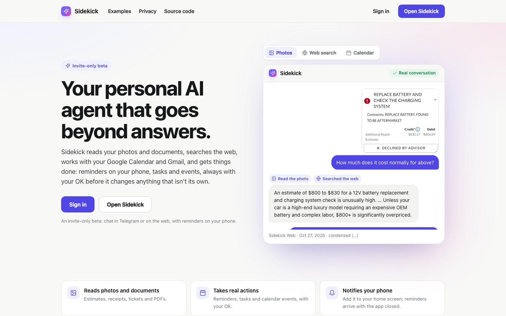
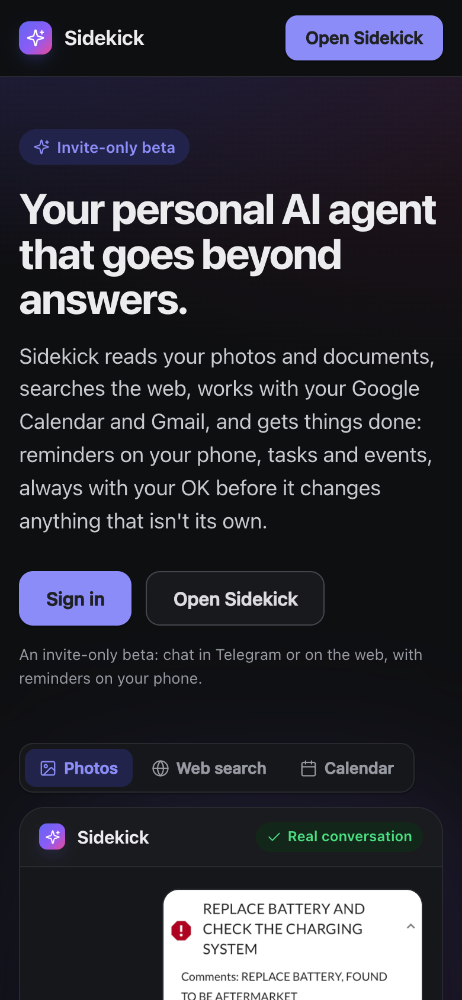
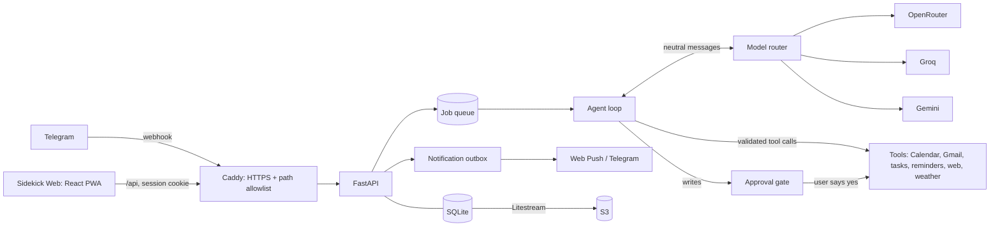

# Sidekick

[](https://github.com/np2400/sidekick/actions/workflows/ci.yml)

A personal AI assistant that knows your calendar and inbox, built end to end by one person and used every day by
real people. Text it on **Telegram** or use **Sidekick Web**, an installable app with phone notifications; both share
the same conversations. It answers questions about your day and your email, reminds you of things, sends a morning
brief, and **never acts on your behalf without asking**.

**At a glance**

- **Live:** running 24/7 on AWS since October 2026; invite-only, used daily by me and my family.
- **Built from scratch:** Python (FastAPI) and React/TypeScript. No agent framework: a hand-written tool-calling
  loop and a provider-neutral model router over OpenRouter, Groq and Gemini.
- **Integrations:** Telegram bot (webhook), Google Calendar and Gmail (per-user OAuth 2.0), Web Push, web search.
- **Quality:** 515 offline tests, a 55-case live evaluation suite with a regression gate, CI/CD with automatic rollback.
- **Cost:** about $0.001 per message.

## Screenshots

<p>
  
  
</p>

## What it can do

| | Ask it… | What happens |
|---|---|---|
| 📅 **Calendar** | "What's on my calendar tomorrow?" · "When am I meeting Alex?" · "Add dinner with Sam Friday at 7" | Reads Google Calendar, searching by person, place or topic (and retrying with just a first name when a spelling doesn't match). Events are only *proposed*: nothing is created until you tap ✅. Dates without times become all-day events. |
| 📧 **Email** (read-only) | "What's my flight booking number for December?" · "How much did I spend on takeout this week?" | Searches Gmail, opens the right email and answers, including the text of PDF attachments, **images inside emails** and scanned PDFs. Checks for a cancellation before calling a booking confirmed. It can never send, delete or change email. |
| ⏰ **Reminders & tasks** | "Remind me to call Dad tomorrow at 10" · "every weekday at 9am" · "Add a task to buy milk" | Reminders arrive as phone notifications and in Telegram, with Done, Snooze and Tomorrow buttons. A built-in task list, or Todoist. |
| ☀️ **Morning brief** | Pick a time; optionally say what else matters to you | Today's calendar, what needs you, 3–4 useful emails (receipts, confirmations, statements), the next 3 days, and one next step. Or "Make my brief now" on the web. |
| 📷 **Photos & PDFs** | Send a receipt or flyer: "Add these dates to my calendar" | Reads photos with a vision model; PDFs uploaded on the web are read and deleted after 10 minutes. |
| 🌐 **Web & weather** | "Who won the Mariners game?" · "Weather in Seattle this weekend?" | Web search with page reading; real forecasts with "today" and "tomorrow" in your own timezone. |
| 👥 **Sharing** | The owner sends an invite link | Join in Telegram, or on the web with Google sign-in (no Telegram needed). Each person's data is fully separate, and each person connects **their own** Google account on the Apps page or with `/connect`. Everyone can export or delete everything stored about them, on the web or in Telegram. |

## Engineering highlights

- **Approval gate in code, not in the prompt.** The model can only *propose* a calendar event or a task; code
  holds it until the user taps ✅, and executes it at most once, even across crashes and retries.
- **Model router with fallback and privacy routing** (`app/llm/`). One neutral message format across OpenRouter,
  Groq and Gemini: retries, a circuit breaker, per-answer cost tracking, and private content (email, calendar,
  photos) sent only to providers that don't keep or train on it, never to a free tier that may. Photos and email
  images go to vision models; a PDF only to models that read PDFs.
- **Code decides, the model writes.** Wherever a model was unreliable in production traces, the decision moved into
  code: timezone and weekday math, sorting email from people vs. automated mail (Gmail categories and bulk-mail
  headers), which email copy to read (HTML vs. a plain-text stub), when to widen an email search, and when an image
  needs a vision model.
- **Durable request processing.** Every message is a job in SQLite, picked up by worker threads with heartbeats.
  A restart mid-answer resumes the job; an outside write whose result is unknown is reported as "uncertain" instead of
  being repeated.
- **Notifications that don't get lost.** Reminders and briefs are written to an outbox, sent with Web Push (VAPID,
  RFC 8291 encryption) and retried; a notification center keeps them on the web.
- **Privacy by default.** Logs and traces hold metadata only (never message text or tool arguments). Conversations,
  tokens and personal notes are encrypted at rest. Instructions inside emails and web pages are treated as untrusted.
- **Safe deploys.** CI gates every deploy; the server deploys, health-checks and rolls back by itself. Database
  migrations are rehearsed first on a backup restored from S3.

## Problems found in real use, and how they were fixed

Daily use found what tests didn't. Each fix below shipped with a test, so it stays fixed.

| What went wrong | Root cause | Fix |
|---|---|---|
| Gmail stopped working, but the Apps page still said "Connected" | Google had expired the sign-in; the page read the saved permissions and never asked Google | The status now checks with Google, tells `invalid_grant` apart from an outage, and offers Reconnect |
| A receipt emailed as a photo was answered with a different receipt | The email had no subject or text, only an image, so a word search couldn't find it | Code narrows the search by the user's day and sent/received; the model can look at images inside emails |
| An order total couldn't be found in a food-delivery email | The plain-text copy was only a link; the details were in the HTML copy | Code reads the HTML copy when it's longer, without its styles and scripts |
| A booking number was missing from the answer | Email previews had been cut too short to save tokens | Restored full previews and email bodies |
| The morning brief gave an event the wrong weekday | The model did date arithmetic from a bare date | Event days are written out in code, in each person's timezone |
| Asked to finish a task in Todoist, it said it had "checked Todoist" | Only the built-in list was connected | The prompt states exactly what's connected; it offers the built-in list instead |

## How it works



| Where | What |
|---|---|
| `app/agent.py` | Tool-calling loop, tool schemas, approval gate, per-message tool budgets, code checks on replies (dates, sources, "can I open your email?") |
| `app/llm/` | Router, OpenAI-compatible and Gemini adapters, cost and privacy rules |
| `app/jobs.py`, `app/notifications.py`, `app/push.py` | Durable jobs, notification outbox, Web Push |
| `app/gmail.py`, `app/gcal.py`, `app/google_web.py` | Gmail (read-only), Calendar, per-user Google OAuth 2.0 with PKCE and a single-use state |
| `app/brief.py`, `app/daily.py` | Morning brief: facts gathered and sorted in code, one model call writes it |
| `app/web_api.py`, `web/` | The web app's API, and the React + TypeScript app (Vite) |
| `evals/` | Synthetic dataset (55 cases), scorers, runner and regression gate |
| `docs/web-architecture.md` | Design decisions, trade-offs and milestones |

Every message produces one trace with metadata only (models, tools, timing, cost), kept 90 days:
`python -m app.traces` shows the recent ones.

## How it's tested

| Layer | Runs | What it checks |
|---|---|---|
| **Offline tests** (`pytest`, 515) | Every push, in CI | Rules that must never break: no write without approval, at-most-once execution, one account can never see another's data, no private content in logs, crash recovery, router fallback and privacy. Fake Google, fake models, network blocked. |
| **Live evals** (`python -m evals.run`) | Manually, with API keys | Real models on 55 synthetic cases (prompt injection in web results and emails, cancelled bookings, photos, follow-ups), scored on success, safety and efficiency, with a spending cap. |
| **Regression gate** (`python -m evals.compare`) | After each eval run | Fails if any safety case fails, or a model's pass rate drops against the saved baseline. |

CI also builds the web app, lints (`ruff`) and scans the full git history for secrets (`gitleaks`).

## Run it locally

```bash
python3 -m venv .venv && source .venv/bin/activate
pip install -r requirements.txt
cp .env.example .env              # fill in your keys (see the comments in the file)
uvicorn app.main:app --reload

cd web && npm install && npm run dev   # Sidekick Web on http://127.0.0.1:5173
```

For Telegram, expose the server with a tunnel (e.g. `cloudflared tunnel --url http://127.0.0.1:8000`), then
`python -m app.set_webhook https://<your-tunnel>` and `python -m app.google_auth` once for the owner's Calendar and Gmail (on a server with a domain, everyone can
connect from the Apps page instead). A bot
delivers to one webhook at a time, so use a separate test bot locally.

## Running in production

One small AWS server (EC2 t4g.micro, ARM) with Docker Compose: Caddy (Let's Encrypt HTTPS; only the webhook, the
API, sign-in and the web app are reachable), Sidekick (FastAPI, job workers and the reminder scheduler in one process,
so the scheduler runs exactly once), and Litestream streaming every database change to S3.

- **Deploys:** push to `main`. When CI passes, it moves the `production` branch; a systemd timer on the server pulls
  it within 5 minutes, rebuilds, watches health for a soak period, rolls back automatically if anything looks wrong,
  and reports on Telegram. The server only pulls, so GitHub holds no server credentials.
- **Migrations:** additive, rehearsed on a backup restored from S3 (`python -m app.db.rehearse` checks every table,
  account isolation and that the previous version still runs), then deployed by hand with a safety copy.
- **No AWS keys on the server:** S3 access comes from an instance role scoped to one bucket, with IMDSv2 and a hop
  limit of 1 so the app container can't read the role's credentials.
- **Health means "can do its job":** `/health` fails if the scheduler or the job workers stall, so the uptime monitor
  catches a stuck process, not just a dead web server.
- **Hardening:** non-root container, secrets only in a `chmod 600` `.env`, SSH keys only, firewall on 22/80/443.

## Security and privacy

Secrets live in `.env` and are never copied into the Docker image. Gmail access is read-only by scope; Google tokens
are encrypted with a key kept outside the database and its backups. Web requests that change anything must come from
Sidekick's own pages (Origin check); push endpoints are limited to known push services. See the
[privacy policy](site/privacy.html) for what Sidekick accesses and stores, and how to export or delete it.

## About

Designed, built and run by Neel Parekh, from the first webhook to the AWS deploy: APIs and webhooks, OAuth, LLM
tool calling, evaluation, and operating a service people rely on every day.
