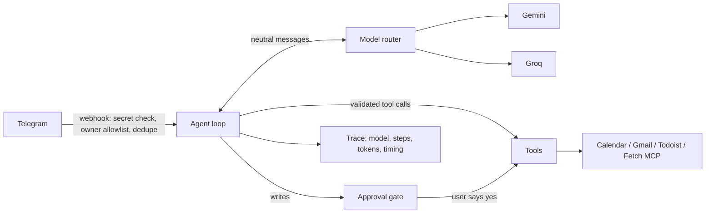

# Sidekick

[](https://github.com/np2400/sidekick/actions/workflows/ci.yml)

A personal AI assistant you text on Telegram. Ask it about your day, your calendar or your inbox, have it read a web page, or tell it to add something to your list. It **asks for your approval before it creates anything**.

No sign-up: your Telegram account is your identity. Calendar, Gmail and Todoist are optional connections you turn on if you use them. Built-in tasks and reminders that need no other app are next on the roadmap; today, tasks are saved to Todoist.

Built from scratch in Python (FastAPI), with no agent framework: a hand-written tool-calling loop, a provider-neutral model router, an offline test suite and a live evaluation harness.

> Status: working personal prototype (single user, runs locally behind a tunnel). Next: built-in tasks and reminders, a database, deployment, then a small invite-only beta.

## What it does

- **Chat on Telegram:** "What's on my calendar tomorrow?", "Add a task to call the dentist", "Summarize Sam's latest email", "/brief".
- **Approval before writes:** the model can only *propose* a task or event; code holds it until you reply yes.
- **Optional integrations:** Google Calendar and Gmail read-only (OAuth 2.0 with PKCE), Todoist (API token), web pages through the Fetch MCP server.
- **MCP both ways:** Sidekick uses an external MCP server, and exposes its own read-only tools to MCP clients.

## How it works



Every message produces one JSON trace line with metadata only (no message text, no tool arguments).

- `app/agent.py`: tool-calling loop, tool schemas, approval gate, crash containment.
- `app/llm/`: router with retries, fallback across Gemini and Groq, circuit breaker, privacy routing (email content only to allowed providers), cost estimates.
- `app/trace.py`, `app/logging_setup.py`: per-message trace and correlation ids on every log line.
- `evals/`: synthetic dataset, scorers and runner for comparing models.

## Run it locally

```bash
python3 -m venv .venv
source .venv/bin/activate
pip install -r requirements.txt
cp .env.example .env        # fill in your keys (see comments in the file)
uvicorn app.main:app --reload
```

To talk to it from Telegram, expose the server with a tunnel (e.g. `cloudflared tunnel --url http://127.0.0.1:8000`) and register the URL:

```bash
python -m app.set_webhook https://<your-tunnel>.trycloudflare.com
python -m app.google_auth   # one-time Google sign-in for Calendar/Gmail
```

## How it's tested

Three layers, from fast and free to slow and real:

| Layer | Runs | What it checks |
|---|---|---|
| **Offline tests** (`pytest`) | On every push, in CI | The rules that must never break: no write without approval, no private content in logs, a crashing tool can't crash the agent, duplicate deliveries are ignored, router retry/fallback/privacy logic. Fake world, scripted model, network blocked. |
| **Live evals** (`python -m evals.run`) | Manually (needs API keys) | Real models on 21 synthetic requests, scored on task success, safety and efficiency. Writes a comparison report to `evals/reports/`. |
| **Regression gate** (`python -m evals.compare`) | After each eval run | Fails if any safety case fails, or a model's pass rate drops more than 5 points against the saved baseline. |

```bash
pytest -q
python -m evals.run --models groq:qwen/qwen3.8-27b,groq:openai/gpt-oss-120b --repeat 2
python -m evals.compare evals/reports/<timestamp>.json          # check against the baseline
python -m evals.compare evals/reports/<timestamp>.json --save   # accept a good run as the new baseline
```

CI also runs a lint for real bugs (`ruff`) and a secret scan of the full git history (`gitleaks`).

## Security

Secrets live in `.env` and Google token files, which are git-ignored. Logs record metadata only. Gmail access is read-only by scope, and content from emails and web pages is treated as untrusted input.
