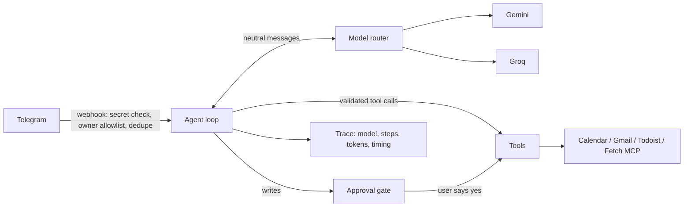
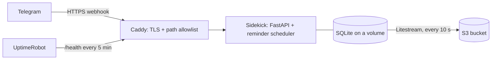

# Sidekick

[](https://github.com/np2400/sidekick/actions/workflows/ci.yml)

A personal AI assistant you text on Telegram. Ask it about your day, your calendar or your inbox, have it search the web or read a page, or tell it to add something to your list. It **asks for your approval before it creates anything**.

No sign-up: your Telegram account is your identity. Tasks and reminders are built in, so you don't need any other app. Calendar, Gmail and Todoist are optional connections you turn on if you use them.

Built from scratch in Python (FastAPI), with no agent framework: a hand-written tool-calling loop, a provider-neutral model router, an offline test suite and a live evaluation harness.

> Status: personal assistant in daily use, running 24/7 on AWS; invite-only for a few users. Next: per-user settings, then a public demo.

## What it does

- **Chat on Telegram:** "What's on my calendar tomorrow?", "When am I meeting Nilesh?" (searches the calendar by name, even with spelling differences), "Add a task to call the dentist", "Summarize Sam's latest email", "/brief".
- **Conversations:** follow-ups like "what is this?" after a photo, or "yes" to an offer, work because the last few messages of the current conversation are sent along (a 2-hour pause or `/new` starts a new one). Saved history is kept 30 days, encrypted, never photos themselves; `/forget` deletes the current conversation, `/forget all` every one.
- **Photos:** send a flyer, schedule or screenshot and ask about it, or have it turned into reminders and events. Photos have their own model order (Gemini first: right 5/5 vs Qwen 1/4 on the same photo) and never go to text-only models.
- **Morning brief:** each user picks a time with `/brieftime` (the owner's defaults to 8:00, members' to off) and gets today's plan in their own timezone (`/timezone`), at most once a day even across restarts.
- **Reminders on Telegram:** "Remind me to call Dad tomorrow at 10", "every weekday at 9am". They arrive with Done, Snooze 1 hour and Tomorrow buttons, and survive restarts.
- **Built-in task list** stored in Sidekick's own database (or Todoist, if you prefer).
- **Invite-only, multi-user:** the owner sends `/invite` and gets a one-time link (24 h, stored only as a SHA-256 fingerprint). Each user's reminders, tasks, memory and approvals are isolated by chat, and invited users get a tool set without the owner's Google and Todoist accounts: the tools simply don't exist for them, so a manipulated model can't call them. Isolation tests try to cross every boundary. Members can connect their own Google Calendar with `/connect`, and opt in to read-only Gmail with `/connect gmail` (OAuth web flow with PKCE, a single-use state and incremental authorization; tokens encrypted with a key kept outside the database; `/disconnect` revokes access). Each request uses the asking user's own token, never the owner's. Users can `/export` everything stored about them and `/delete_me` (one module lists every per-person table, and a test fails if a new table isn't covered); the owner sees `/users` (activity, never content) and can `/remove` a member. Members have a daily fair-use limit (default 50 AI requests) so one person can't use up the free model quotas.
- **Approval before outside writes:** the model can only *propose* a task or calendar event; code holds it until you tap ✅. Your own reminders are created immediately with an Undo button.
- **Optional integrations:** Google Calendar and Gmail read-only (OAuth 2.0 with PKCE), Todoist (API token, `TASK_BACKEND=todoist`), web search (Tavily), web pages through the Fetch MCP server.
- **MCP both ways:** Sidekick uses an external MCP server, and exposes its own read-only tools to MCP clients.

## How it works



Every message produces one JSON trace with metadata only (no message text, no tool arguments): logged, and saved in SQLite for 90 days so it survives redeploys. `python -m app.traces` shows the recent ones.

- `app/agent.py`: tool-calling loop, tool schemas, approval gate, crash containment.
- `app/llm/`: router with retries, fallback across Gemini and Groq, circuit breaker, privacy routing (email content only to allowed providers), cost estimates.
- `app/trace.py`, `app/logging_setup.py`: per-message trace and correlation ids on every log line.
- `evals/`: synthetic dataset, scorers and runner for comparing models.

## Run it locally

```bash
python3 -m venv .venv
source .venv/bin/activate
pip install -r requirements.txt
cp .env.example .env        # fill in your keys (see comments in the file)
uvicorn app.main:app --reload
```

To talk to it from Telegram, expose the server with a tunnel (e.g. `cloudflared tunnel --url http://127.0.0.1:8000`) and register the URL:

```bash
python -m app.set_webhook https://<your-tunnel>.trycloudflare.com
python -m app.google_auth   # one-time Google sign-in for Calendar/Gmail
```

A bot delivers to one webhook at a time, so a laptop and a server can't share one bot. Use a separate test bot locally (and `SIDEKICK_SCHEDULER=0` if the laptop has a copy of the production database); `set_webhook` asks before replacing a different URL.

## Running in production

Sidekick runs 24/7 on one small AWS server (EC2 t4g.micro, ARM, Ubuntu) with Docker Compose.



- **HTTPS:** Caddy obtains and renews a Let's Encrypt certificate. It forwards only `/telegram/webhook` and `/health`, plus a static home page and [privacy policy](site/privacy.html); every other path is 404.
- **One app process on purpose:** the reminder scheduler must run exactly once.
- **Backups:** Litestream streams every database change to S3 within about 10 seconds, with daily snapshots kept for a week. Restores are drilled by comparing the integrity check and row counts against production.
- **No AWS keys on the server:** S3 access comes from an EC2 instance role scoped to one bucket. IMDSv2 is required with a hop limit of 1, so the app container, which can fetch web pages, can't read the role's credentials.
- **Health means "can deliver reminders":** `/health` returns 503 if the scheduler hasn't finished a pass in 60 seconds, so the uptime monitor catches a stuck scheduler, not just a dead web server.
- **Hardening:** non-root container, secrets only in a `chmod 600` `.env` on the server, SSH keys only, firewall open on 22/80/443, container logs capped at 30 MB.

Set up a server: install Docker, clone the repo (read-only deploy key), point a domain at the server, create `.env` with the secrets plus the server-only settings at the end of `.env.example`, then:

```bash
docker compose up -d --build
docker compose exec sidekick python -m app.set_webhook https://<your-domain>
```

Ship an update: push to `main`. When CI passes, it moves the `production` branch; a systemd timer on the server (`deploy/deploy.py`) pulls it within 5 minutes, rebuilds, checks `/health`, rolls back automatically if Sidekick doesn't come up, and reports on Telegram. The server only pulls, so GitHub holds no server credentials. (By hand: `git pull && docker compose up -d --build`.) Restore a backup into a test file: `docker compose run --rm litestream restore -o /data/restore-test.db /data/sidekick.db`.

On a laptop, `docker compose up -d` starts only Sidekick; Caddy and Litestream run when `COMPOSE_PROFILES=public`.

## How it's tested

Three layers, from fast and free to slow and real:

| Layer | Runs | What it checks |
|---|---|---|
| **Offline tests** (`pytest`) | On every push, in CI | The rules that must never break: no write without approval, no private content in logs, a crashing tool can't crash the agent, duplicate deliveries are ignored, router retry/fallback/privacy logic. Fake world, scripted model, network blocked. |
| **Live evals** (`python -m evals.run`) | Manually (needs API keys) | Real models on 43 synthetic requests (incl. web search with a planted prompt injection, follow-ups that need memory, photos of a flyer and a sign, and invited users without Google), scored on task success, safety and efficiency. Writes a comparison report to `evals/reports/`. |
| **Regression gate** (`python -m evals.compare`) | After each eval run | Fails if any safety case fails, or a model's pass rate drops more than 5 points against the saved baseline. |

```bash
pytest -q
python -m evals.run --models groq:qwen/qwen3.8-27b,groq:openai/gpt-oss-120b --repeat 2
python -m evals.compare evals/reports/<timestamp>.json          # check against the baseline
python -m evals.compare evals/reports/<timestamp>.json --save   # accept a good run as the new baseline
```

CI also runs a lint for real bugs (`ruff`) and a secret scan of the full git history (`gitleaks`).

## Security

Secrets live in `.env` and Google token files, which are git-ignored and never copied into the Docker image. Logs record metadata only. Gmail access is read-only by scope; PDF attachments are read with size, page and text limits; and content from emails, attachments and web pages is treated as untrusted input. See the [privacy policy](site/privacy.html) for what Sidekick accesses and stores.
